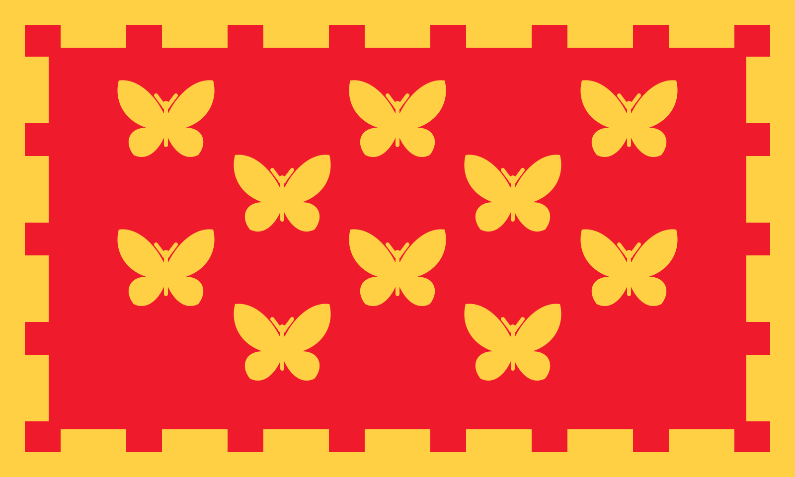

# Ten butterflies for Manchester

An optional meetup-artwork draft inspired by the Greater Manchester flag: ten gold butterflies instead of ten towers, in the same 3–2–3–2 arrangement, with a red field and gold battlement border.

- [View or download the PNG](manchester-butterflies.png) — 1600 × 960 pixels.
- [Editable SVG](manchester-butterflies.svg) — vector source for resizing or adapting.

Made for the Manchester meetup organizers to use or adapt if they like. Unofficial concept, not an adopted identity or an official Greater Manchester mark. This example does not change the app's default branding.

The butterfly artwork and this adaptation are provided under this repository's [MIT license](../../LICENSE). The design references the flag's arrangement and approximate palette; the source SVG is newly drawn rather than a modified third-party flag image.
